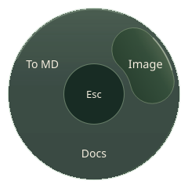
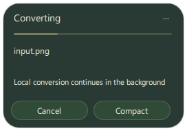

# Filewheel

Convert files from Windows File Explorer or Dolphin on KDE Plasma Linux.
Middle-click a file, choose
an output format from the wheel, and let Filewheel create a converted copy.
Your original file stays in place.

This project was fully **vibecoded with OpenAI Codex**. It was created as an
experiment to see what Codex could build, from the app itself to its installer.

This branch, `feat/linux-port`, includes the Linux application and preserves the
Windows implementation. Ordinary Dolphin middle-click is configured automatically
at installation: Filewheel becomes the second application for supported MIME
types while your default stays first. No patched Dolphin or global input capture.

## Version 0.3.1 — Windows and Linux

[Download the release](https://github.com/artlsvy/fileconverter/releases/tag/v0.3.1).
Both installers are built from the same tagged source by GitHub Actions. Publication
requires both platform build/check jobs to pass. Check the release assets and
linked workflow run rather than using a binary attached to a random comment.

- **Linux:** download `Filewheel-Linux-x86_64.AppImage`, make it executable, run it
  and choose **Install for this user**. Quit older Filewheel tray instances first.
  Python, Qt, FFmpeg, Pandoc, LibreOffice and offline English Tesseract OCR are
  included. Requires x86_64 glibc2.35+ and normal desktop libraries/FUSE. Tested on
  Plasma Wayland; GNOME/native Mouse3 and every Linux distribution are not claimed.
- **Windows11 x64:** download `FilewheelSetup.exe`, quit older instances and run
  the installer. Conversion tools and Python are included; scanned PDFs use local
  Windows OCR languages. The installer is unsigned; SmartScreen warnings may occur.

Linux details: [usage/install/remove](LINUX_USE.md),
[packaging/requirements](LINUX_PACKAGING.md), [actual verification](LINUX_STATUS.md).
Linux progress stays inside the monitor work area; image-only PDFs use local OCR
and Markdown preserves page images even when there is no recognized text.

Releases include `SHA256SUMS.txt` and GitHub build attestations. Verify a download:

```sh
sha256sum -c SHA256SUMS.txt
gh attestation verify Filewheel-Linux-x86_64.AppImage --repo artlsvy/fileconverter
# Windows: gh attestation verify FilewheelSetup.exe --repo artlsvy/fileconverter
```

Provenance establishes where/from which source a binary was built, **not a
virus-free certification**. Builds use pinned/hash-checked inputs; published logs,
checksums and source allow independent inspection. [Release process](RELEASING.md).

## What's new in v0.3

- Convert supported video combinations across MP4, MOV, MKV and WebM. AVI and
  M4V files are accepted as inputs.
- Convert audio to MP3, M4A, WAV or FLAC; OGG and Opus are supported as inputs.
  Extract audio from supported videos.
- Use local Windows OCR to convert scanned PDFs to DOCX or Markdown.
- Choose an accent color for the glass interface; text contrast adjusts
  automatically. Optionally start Filewheel when you sign in to Windows.

## A look at the app

These are real UI captures with transparent backgrounds.

| Choose a format | Track a conversion | See more details |
| --- | --- | --- |
|  |  |  |

## Download and install

**[Download Filewheel v0.3.1](https://github.com/artlsvy/fileconverter/releases/tag/v0.3.1)**

1. Quit any older copy of Filewheel.
2. Open **FilewheelSetup.exe** and follow the installer.
3. Launch Filewheel from the Start menu or the installer's Finish page.

You need **Windows 11 on an Intel or AMD 64-bit PC**. Conversion tools are
included; you do not need to install Python. Local OCR uses Windows' installed
recognition languages (see below).
If compatible LibreOffice or Pandoc installations are found, Filewheel can use
those instead of installing its own copies.

## Use it

1. Find a file in File Explorer.
2. Middle-click it with your mouse, or use a touchpad gesture set to middle-click.
3. Choose a category, then a file format.
4. Follow the progress indicator until the conversion finishes.

When the format wheel is open, moving the pointer outside its boundary closes
it by design, keeping Filewheel quick to use. Press **Esc** to close it manually
instead.

You can also right-click a file and choose **Show more options > Send to > Filewheel**
if you selected that option during installation.

Filewheel handles pictures, PDFs, Word documents, presentations, spreadsheets,
Markdown and text. Audio conversion offers MP3, M4A, WAV and FLAC outputs, with
OGG and Opus also accepted as inputs. Supported videos can be converted among
MP4, MOV, MKV and WebM where the source and target combination is available;
AVI and M4V are accepted as inputs. MP3, M4A and WAV audio can be extracted from
supported videos. The wheel only shows conversions available for that file.
Results explain when streams were re-encoded or tracks were omitted. Converting
lossy audio to FLAC cannot restore quality lost in the original.

For **image-only PDF to DOCX**, Filewheel uses local Windows OCR. It creates
editable text with simplified layout and includes the original pages as images
for reference. Check recognized text for mistakes, especially numbers and formulas.
PDFs with an existing text layer keep using the normal layout converter; mixed
text/image PDFs may still contain non-editable scanned pages. Image-only PDF
to Markdown also uses local OCR and saves each original page beside the Markdown
file as a linked PNG. Keep the Markdown file and its page images together.

OCR needs an installed Windows recognition language. Filewheel uses a supported
Windows profile language, falling back to an installed recognition language.
If none is installed, add OCR in **Settings > Time & language > Language & region
> Language options**. Filewheel never uploads pages or downloads language packs.

## Tray menu

Find Filewheel beside the Windows clock. You may need to open the hidden icons.

- **Enable wheel** turns mouse and touchpad activation on or off.
- **Start on login** starts Filewheel when you sign in to Windows.
- **Accent color** changes the glass wheel, hover lens and progress display.
  Text contrast adjusts automatically, and the color is saved for next launch.
- **Reset accent color** restores the original appearance.
- **Quit Filewheel** closes the app.

Mouse and touchpad activation are on by default. Start on login is optional.
Mouse and laptop touchpad gestures open the wheel directly, without a file-path
confirmation prompt. The same file validation checks still apply.

## Your files stay on your PC

Conversions work locally. No account, internet connection or uploads are needed.
To uninstall, open **Windows Settings > Apps > Installed apps > Filewheel**.
See the [privacy policy](PRIVACY.md) for details about local preferences and logs.

[Installer and build notes](INSTALL.md)

## Source and signing

Filewheel's own source code is licensed under [AGPL-3.0-or-later](LICENSE).
The installer includes separately licensed open-source conversion tools; see
[the build notes](INSTALL.md) for their source and license information.

The current installer is unsigned. See the [code signing policy](CODE_SIGNING.md)
for the planned SignPath Foundation release process and verification steps.
