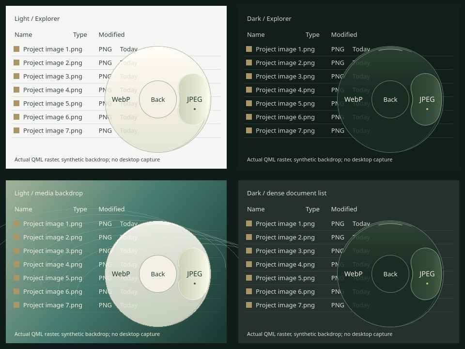

# Performance evaluation and UI architecture

## Recommendation and evidence boundary

Keep the Python controller, Explorer adapters and isolated converter workers.
Retain QWidget as the default renderer. Evaluate an opt-in Qt Quick glass wheel
before changing that default. There is currently **no measured reason to rewrite
the desktop host in C++ or Rust**. Native Windows acceptance is outstanding.

Baseline measured on 2026-10-26 with CPython 3.14.4, PySide6 6.12.0, Linux Qt
`offscreen`, no desktop/display/GPU presentation available. Synthetic preview PNG
invocations exercise the actual QWidget, with one fresh process followed by 100
warm operations. File conversion uses a separate CPU fixture in the production
spawn supervisor, not a real document. Disk caches were not cleared: “cold” here
means a fresh process, not a cold operating-system cache. The committed
[raw report](performance/widgets-baseline-linux.json) records the complete run.

| Boundary | Observed result | What this establishes |
|---|---:|---|
| Fresh benchmark process to first paint | 140.60 ms | Python/Qt/bootstrap/fonts together; preview registry |
| UI imports inside fresh process | 87.19 ms | Bootstrap costs dwarf warm Python event dispatch |
| First QWidget show to paint | 16.06 ms (one sample) | Includes first-use raster/font setup; not compositor presentation |
| Warm present to paint | p50 0.979 / p95 1.046 ms | Resident window reuse; 100 samples |
| Warm show to paint | p95 0.886 ms | Qt event dispatch plus raster paint |
| Move event to paint | p50 0.937 / p95 0.998 ms | Synthetic input, no hardware/OS input latency |
| Category choice to paint | p95 0.965 ms | No artificial level-change delay |
| Paint GUI-thread CPU time | p50 0.651 / p95 0.713 ms | 300 warm paints; QPainter/font work dominates this small interval |
| Peak process RSS | 65.13 MiB | Includes Qt UI and subsequent fixture supervision; not bundle size |
| 5 ms heartbeat during spawned CPU conversion | p95 gap 5.082 / max 5.589 ms | Parent event loop remains responsive; child PID differs |

A second fresh-process run by the implementer measured 140.30 ms cold and
1.042 ms warm p95. An earlier exploratory cold sample was approximately 181 ms.
These are local samples, not universal startup promises or a statistically
controlled comparison across machines.

A separate local import/registry probe after QApplication creation measured:
manager import 10.88 ms; first actual `ConversionManager()` capability discovery
49.50 ms; repeated discovery 1.28 ms; 27 installed conversion pairs. The UI
benchmark deliberately uses a preview registry, so do not mistake its 141 ms
for the complete real launcher, default registry, COM bootstrap or frozen EXE.

## Where time is spent

- **Python event handling:** warm synthetic interaction including painting is
  under 1.1 ms p95 here. The test does not isolate every binding call, but that
  upper bound does not support replacing Python just to accelerate dispatch.
- **Rendering:** QPainter CPU painting is measurable (~0.7 ms p95 here), well
  below a 16.67 ms frame budget. A more elaborate lens could change that. Qt
  Quick is being evaluated for retained scenegraph animation and visual quality,
  not as an assumed cure for an observed slow QWidget.
- **Explorer resolution:** COM/UIA/Shell and queue latency are Windows-only and
  **pending**. Historical supplied diagnostic captures are not a benchmark of
  today's mapping code. They cannot establish today's bottleneck.
- **Startup:** imports, QApplication/fonts and first engine discovery are much
  larger than warm interaction in this environment. The resident tray avoids
  repeating most UI bootstrap. Repeated explicit-path launches also use the
  existing single-instance forwarding route.
- **Converters:** duration depends on document, engine and worker bootstrap.
  They already run in a separate interpreter, protecting the hook/GUI GIL.
  A C++ host would not automatically accelerate Pillow/PyMuPDF native codecs,
  pdf2docx, MarkItDown or LibreOffice. Measure representative files separately.

No claim is made about the principal Windows bottleneck until native measurements
are recorded. Candidate confirmation includes deliberate user delay and must not
be counted as resolver/UI latency.

## Architecture comparison

| Concern | A: optimized Python + QWidget | B: Python + Qt Quick/QML | C: C++/Qt host + Python workers |
|---|---|---|---|
| Warm input-to-popup | Existing 1.046 ms p95 local UI boundary; Explorer pending | Same resolver/registry; measure scene startup and warm frames | Same external COM costs; potential dispatch reduction unmeasured |
| Animation | CPU paint each frame, currently cheap | Retained GPU scenegraph on normal RHI; software fallback also needs measurement | Can use identical QML scene; C++ alone does not improve GPU behavior |
| Startup | Local preview process ~141 ms; normal EXE pending | Adds QML imports/engine; comparison follows prototype | Could remove PySide/Python host startup, but Qt/QML and converter Python remain |
| Memory | Local fixture peak 65.13 MiB | Extra QML engine/scenegraph/device resources; measure, do not assume | Native host may be smaller; worker interpreter/engine memory unchanged |
| Explorer integration | Working Python COM/UIA adapter and tests | Reuses it unchanged | Port/rebind COM apartments, lifetimes, flags and evidence protocol, with new Windows risks |
| Conversion compatibility | Current Python engines | Identical manager/jobs/engines | Keep Python workers; needs a separate host-worker protocol and embedding/distribution plan |
| Packaging | Working onedir recipe | Must include QML files/import plugins and QtQuick DLLs | Compiler/toolchain plus Qt host, Python runtime and converter dependencies still shipped |
| Size | Dominated by Python/converter/Qt stack; actual installed folder should be measured on Windows | Some additional Quick/QML plugins; not an Electron/WebView runtime | Cannot simply drop Python/PySide if existing workers still import package modules |
| Reuse/maintenance | Lowest risk, all existing lifecycle tests | Moderate new UI adapter, shared state/controller/worker, reversible selection | Highest migration/test burden; code reuse mostly workers and data contracts |
| Windows 11 | User-reported working; detailed acceptance queues remain | D3D11/RHI default documented; native graphics/focus/DPI acceptance required | Supported by Qt, but entirely new host acceptance required |

Rust is not proposed: no measured CPU-bound host bottleneck or unique Windows
integration advantage currently justifies a new GUI/FFI/packaging stack.

Choose C only after native timings show a material host-interpreter cost that
remains after caching/window reuse, and a small host spike demonstrates improved
latency/RSS without losing current behavior. Set an explicit improvement budget
before paying that migration cost.

## Opt-in timing procedure

Set `FILEWHEEL_TIMINGS` to an absolute `.json` path **before launching**. The
parent records a bounded 10,000-entry in-memory buffer and flushes once at normal
exit (or explicit flush in a benchmark). No per-frame disk writes, filenames,
window titles, pointer coordinates, remote upload or normal-operation telemetry
are recorded. Use a fresh output filename: existing files/links are never
overwritten, and a flush is once-only. Do not force-kill when collecting timings; that loses the buffer.

On Windows, with an existing writable logs directory and the old app closed:

```powershell
$env:FILEWHEEL_TIMINGS = Join-Path (Get-Location) 'logs\native-widgets.json'
& .\dist\Filewheel\Filewheel.exe --tray
# Enable the existing Mouse3 workflow. Exercise 30+ allowed file activations,
# hover changes and category selections, then exit normally via the tray.
Remove-Item Env:FILEWHEEL_TIMINGS
```

Recorded stages: `mouse_queue_age` (hook timestamp to resolver entry; includes
queue/controller work), `resolver` (COM/UIA/Shell and evidence callback),
`candidate_from_event` (capture time to assessed candidate), `candidate_to_ui`,
`candidate_to_show` (direct activation only), `present_to_show`, `show_to_paint`,
`move_to_paint`, `choose_to_paint`, `paint_wall`, `paint_cpu`, `registry_startup`.
These stages overlap; **do not sum their percentiles** or equate paint completion
with a displayed frame. No target trust rule is changed by timing probes.

Repeatable local UI benchmark (no Windows APIs):

```bash
.venv-ui/bin/python scripts/benchmark_ui.py --iterations 100 --output /tmp/widgets.json
```

For native Explorer timings compare physical Mouse3 in simple, grouped, large and
multi-tab folders on the same laptop. Keep resolution freshness checks unchanged.
Measure Send to separately: its launch-time cursor and shell dispatch are a
separate invocation path. Record hardware, build, scale, current renderer, sample
count, power mode and fresh-process vs resident context. Touchpad confirmation
remains mandatory and its human response time is excluded.

## Qt Quick evidence and constraints

Qt Quick's [scenegraph](https://doc.qt.io/qt-6/qtquick-visualcanvas-scenegraph.html)
retains renderable geometry and uses RHI; it is not proof of a particular FPS.
[Shapes](https://doc.qt.io/qt-6/qml-qtquick-shapes-shape.html) can be triangulated
and changing paths costs CPU. Animate one item's transform rather than rebuilding
paths for every pointer event. Keep hit geometry independent of the visual lens.

The [ShaderEffect API](https://doc.qt.io/qt-6/qml-qtquick-shadereffect.html) requires
compiled shader resources in Qt 6 and does not run in the software adaptation.
The initial prototype uses gradients and retained shapes instead. No desktop
capture/refraction, browser, Addons or external renderer is needed. Optional
content-only distortion is deferred until it demonstrates a worthwhile benefit.

On [Windows](https://doc.qt.io/qt-6/windows-graphics.html), normal Quick rendering
uses D3D11; WARP and the Quick software adaptation are different fallback paths.
Request an alpha buffer before creating Quick windows and clear transparent.
[QQuickWindow frameSwapped](https://doc.qt.io/qt-6/qquickwindow.html) means queued
for presentation, not physically displayed. Its render-thread signal must not
perform application logic or mutate Qt GUI objects; benchmark observation must
remain minimal/opt-in. GUI-thread afterAnimating is an earlier preparation
boundary and must be labelled separately.

Prototype results, visuals, native instructions and backend selection will be
recorded below when implemented. The original renderer remains available.

## Prototype and moving lens comparison

The Quick prototype is a separate240px QQuickView/scene, using the existing
RadialState and production ConversionJob. Real PNG → JPEG fixture conversion,
keyboard navigation, Back/Escape, actual QML pointer dispatch, transient native
hide and persistent result behavior pass on the software scenegraph. A QML
MouseArea's `wheel` signal shadowed the original context name; actual pointer
coverage caught it, and the scene now resolves its session at the root.

The raised capsule lens is retained geometry, r46..106, rotated along the shorter
arc. Its145ms OutCubic motion,70ms appearance and120ms label emphasis animate
transforms/opacity rather than rebuilding paths or hit regions. The base/rim
remains continuous, without adjacent doubled sector outlines. Reduced-motion
and low-effects modes disable transitions; low-effects material is opaque.
Idle scenes have no perpetual animations or Python frame callbacks when timing
is disabled. The optional shader stage is not justified: the lightweight lens
works without shader binaries, extra sampling or a software-renderer exception.



This board composites actual QML software-renderer grabs over four **synthetic**
Explorer/media backdrops. It is not a Windows screenshot, desktop capture or
proof of native compositing. Pixel tests verify zero-alpha corners and sampled
material/text contrast >=4.5:1 over black and white in both themes/effect modes.
It does not establish every real Windows backdrop, font or display condition.
Regenerate with `scripts/render_glass_preview.py --output-dir docs/performance`.

The following serial local runs use240px for **both** renderers,100 warm
operations each, then a1.2s spawned CPU fixture while hover transitions continue.
[Widget report](performance/widgets240-comparison-linux.json),
[Quick report](performance/quick-comparison-linux.json). The170px baseline above
is retained separately. No Windows Explorer, real hardware input or GPU display
was measured. Quick reports `GraphicsApi.Software`, not hardware acceleration.

| Local observation | QWidget240 | Quick240 + lens |
|---|---:|---:|
| Fresh process to first render boundary | 138.39ms | 167.15ms |
| UI imports | 84.45ms | 98.41ms |
| Peak process RSS incl. fixture supervision | 65.75MiB | 92.81MiB |
| Warm activation p95 | 1.279ms | 1.371ms |
| Hover update boundary p95 | 1.285ms | 5.280ms |
| Category change boundary p95 | 1.119ms | 6.763ms |
| 5ms GUI heartbeat p95/max under spawned work | 5.746/6.742ms | 5.691/6.290ms |
| Active lens frameSwapped intervals | not sampled | p50 15.973/p95 17.733/max21.905ms;67 frames |

**The boundaries differ:** QWidget samples paint dispatch completion, Quick
samples `frameSwapped` (queued presentation). Quick's earlier GUI preparation
stages are separately named `quick_*_to_sync`; those are not render completion.
Do not interpret the table as proof that one renderer displays input N times
faster. The software lens has roughly16ms median frame cadence, with outliers
above16.67ms; it is **not** a verified locked60FPS result or Windows GPU result.
Samples begin at the first110ms hover pulse;145ms transitions overlap later
pulses to exercise active motion without counting the pre-input idle gap.

Quick adds approximately29ms fresh-process time and27MiB peak RSS in this local
comparison. Its benefit is richer retained motion/material, not an established
latency reduction. This is reasonable for an **explicit experimental opt-in**,
not a default replacement. Keep QWidget available and default until Windows
performance, focus, DPI and frozen bundle acceptance pass. C++ migration remains
unjustified by the evidence gathered so far.
